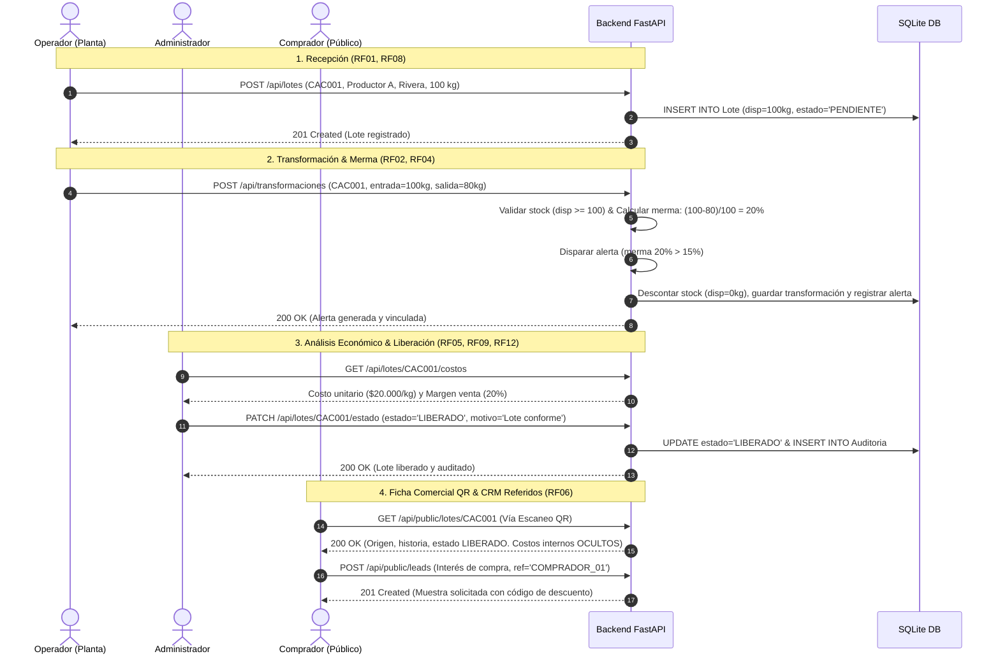
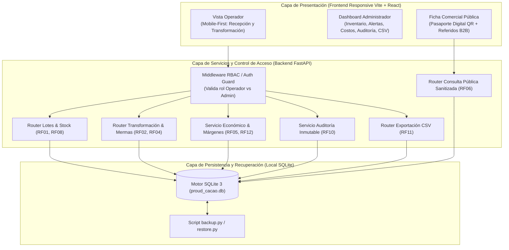
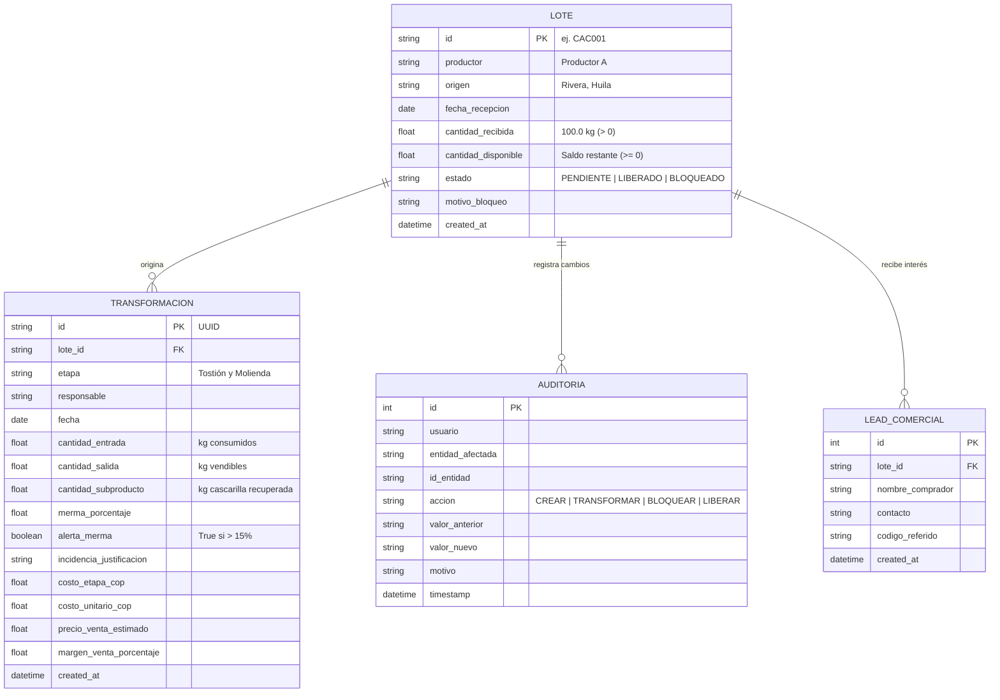

# E03 - DISEÑO DEL PRODUCTO Y DE LA SOLUCIÓN
## Reto: Cacao con historia, calidad y valor — Huila

---

## 1. Flujo Integral de Usuario (Happy Path del Jurado)

---

## 2. Diagrama de Arquitectura de Componentes

---

## 3. Modelo de Datos y Esquema Relacional

---

## 4. Control de Acceso, Reglas de Negocio y Seguridad
- **Aplicación estricta en Backend**: El backend intercepta todas las peticiones a través de dependencias de seguridad FastAPI (`get_current_role`).
- **Separación de Privilegios**:
  - `OPERADOR`: Autorizado para `POST /api/lotes` y `POST /api/transformaciones`. Si intenta ejecutar `PATCH /api/lotes/{id}/estado`, el backend retorna un código HTTP `403 Forbidden` inmediato.
  - `ADMINISTRADOR`: Autorizado para liberar/bloquear lotes, consultar auditoría, costos internos y exportar CSV.
  - `COMPRADOR (Público)`: El endpoint `/api/public/lotes/{id}` utiliza un esquema Pydantic sanitizado (`LotePublicoSchema`) que **omite deliberadamente** los campos `costo_etapa_cop`, `costo_unitario_cop`, `precio_venta_estimado`, `margen_venta_porcentaje` y datos de contacto privado del productor.
- **Regla de Existencias Atómica (RF08)**: 
  Toda transformación se ejecuta bajo transacción de base de datos (`BEGIN IMMEDIATE`). Si `cantidad_disponible < cantidad_entrada`, la transacción se aborta con HTTP `422 Unprocessable Entity` y el saldo permanece inalterado.

---

## 5. Decisiones Técnicas de Arquitectura (ADR - Architecture Decision Records)

### ADR-01: Monolito Modular con Patrón Onion Architecture para Aislamiento del Dominio
- **Contexto**: El reto exige resolver un flujo vertical integrado en 24 horas, garantizando que las reglas de negocio (cálculo de merma del 20%, costo unitario de $20.000 COP/kg, alertas > 15% y control de existencias) se apliquen estrictamente en el backend y no en la interfaz, además de someterse a pruebas automatizadas independientes.
- **Decisión**: Implementar un **Monolito Modular** a nivel de empaquetado y despliegue, estructurando internamente el código bajo el patrón concéntrico **Onion Architecture**. El núcleo de dominio (`domain/`) contiene las entidades puras y las reglas matemáticas del cacao sin ninguna dependencia de frameworks web (FastAPI) ni de persistencia (SQLAlchemy/SQLite). Los servicios de aplicación (`services/`) orquestan los casos de uso, y la infraestructura (`routers/`, `infra/`) se mantiene en la capa exterior.
- **Alternativas Descartadas**:
  1. *Microservicios*: Descartado por complejidad operativa, latencia de red innecesaria y alto riesgo de fallo por conectividad o puertos en el evento de 24 horas.
  2. *Monolito Tradicional Acoplado (Active Record / MVC monolítico)*: Descartado porque mezcla la lógica de cálculo con las llamadas a la base de datos, dificultando pruebas unitarias limpias y aumentando el riesgo de efectos secundarios ante cambios.
- **Limitaciones y Trade-offs Asumidos**: Requiere disciplina de importación en Python (el dominio nunca debe importar módulos de FastAPI o SQLAlchemy). A cambio, permite ejecutar pruebas unitarias del dominio en microsegundos sin necesidad de levantar bases de datos ni servidores.

### ADR-02: SQLite Embebido vs. Servidor PostgreSQL Autónomo
- **Contexto**: El sistema debe ejecutarse de forma limpia y reproducible en local, resistir caídas de conexión a internet del recinto ferial y superar la prueba oficial de respaldo/restauración (criterio de desempate en la evaluación).
- **Decisión**: Utilizar el motor **SQLite 3 nativo** mediante transacciones atómicas (`BEGIN IMMEDIATE` y restricción `CHECK(cantidad_disponible >= 0)`).
- **Alternativas Descartadas**: PostgreSQL o MySQL en contenedores Docker. Introducían sobrecarga de memoria, riesgo de puertos bloqueados en máquinas ajenas y complejidad de scripting para la restauración en vivo.
- **Limitaciones y Trade-offs Asumidos**: Concurrencia de escritura limitada. Para la escala del caso (3 lotes, 2 operadores y consultas de compradores concurrentes en modo lectura), SQLite soporta más de 1.000 lecturas/segundo y tiempos de consulta < 25 ms, cumpliendo con creces la meta de < 3 segundos del reto.

### ADR-03: FastAPI con Validación Pydantic vs. Frameworks Dinámicos
- **Contexto**: La especificación del reto prohíbe guardar datos inválidos (cantidades negativas, campos obligatorios vacíos o división por cero) y exige respuestas de error comprensibles.
- **Decisión**: Emplear **FastAPI con esquemas Pydantic**, garantizando validación estricta de tipos en tiempo de compilación/ejecución y generando documentación OpenAPI interactiva en `/docs` para la inspección directa del jurado.
- **Alternativas Descartadas**: Express.js o Flask sin tipado fuerte, donde la validación manual de cada campo aumenta la probabilidad de omitir casos borde en 24 horas.
- **Limitaciones y Trade-offs Asumidos**: Requiere entorno Python 3.10+, el cual está estandarizado en la documentación de instalación limpia.

---

## 6. Esquema Breve de Pantallas (UI Layouts)

1. **Pantalla Operador (Móvil)**:
   - Encabezado: "CacaoTrace Huila - Registro Operativo".
   - Botón 1: "Recepción de Grano" (Campos: ID Lote, Productor, Municipio, Kg).
   - Botón 2: "Transformación" (Selector de Lote, Kg Entrada, Kg Salida, Subproducto Cascarilla). Al ingresar valores, previsualiza la merma en tiempo real.
2. **Dashboard Administrador (Desktop)**:
   - Tarjetas KPI: Lotes Activos, Kg Disponibles en Bodega, Alertas Activas (Semáforo rojo).
   - Tabla de Lotes con Badge de Estado (`PENDIENTE`, `LIBERADO`, `BLOQUEADO`).
   - Botón "Exportar Resumen CSV" y Botón "Historial de Auditoría".
3. **Ficha Pública Comprador (Mobile-First / QR)**:
   - Imagen de Cacao Fino del Huila, Origen verificado (Rivera), Municipio, Notas sensoriales.
   - Estado: "Certificado y Liberado" (o alerta en rojo si está Bloqueado).
   - Botón "Solicitar Muestra / Código Referido B2B".
